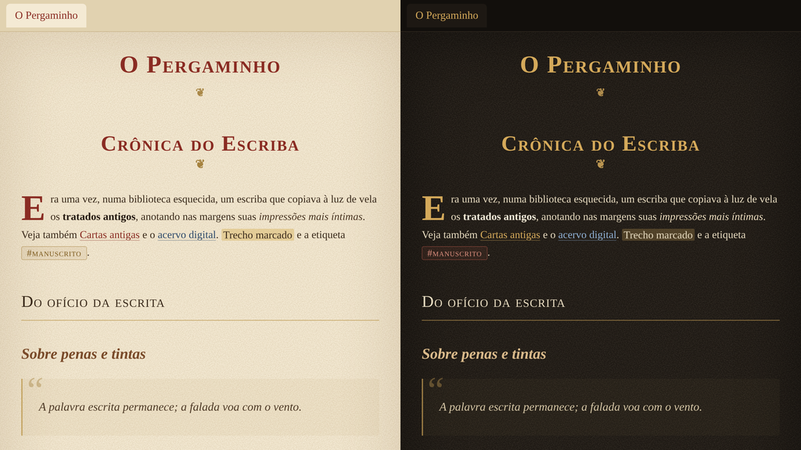

# PaperK

Tema para o [Obsidian](https://obsidian.md) inspirado em papel antigo e pergaminho.



O **PaperK** dá às suas notas a atmosfera de um manuscrito. No modo claro, o **"Pergaminho"**, as notas ganham fundo creme com textura sutil, tinta sépia, títulos em vinho de lacre e ornamentos dourados. No modo escuro, o **"Couro & Vela"**, os tons lembram nogueira e couro de encadernação, iluminados por um dourado de vela. A tipografia clássica, com versaletes nos títulos e serifas elegantes no texto, se une a detalhes de manuscrito: florão sob o título, letra capitular, linha horizontal ornamental e citações com aspas decorativas. Tudo é personalizável pelo plugin Style Settings.

*An old-paper, parchment-inspired theme for Obsidian, with classic typography and elegant palettes for light and dark modes.*

## Destaques

- Títulos em versalete clássico (Cinzel), subtítulos em itálico (Cormorant Garamond) e texto em EB Garamond.
- H1 centralizado com florão ❦, H2 com filete dourado, H3 e H5 em itálico, H4 em versalete espaçado.
- Letra capitular no primeiro parágrafo após um H1 (modo de leitura).
- Linha horizontal ornamental ❧ ✦ ☙ e citações com aspas decorativas.
- Textura de papel e vinheta nas bordas geradas por CSS/SVG embutidos — nada é carregado da internet.
- Tabelas em estilo livro-razão, callouts como fichas de papel, código em fonte de máquina de escrever.
- Paleta verificada quanto ao contraste (texto principal acima de 11:1 no claro e 12:1 no escuro).
- Compatível com o plugin **Style Settings** para ligar/desligar textura, vinheta, ornamentos, capitular, alinhamento do H1, imagens em sépia, interface sem serifa e trocar as fontes.

## Instalação pela comunidade

Assim que o tema estiver aprovado no diretório oficial: **Configurações → Aparência → Temas → Gerenciar**, pesquise por **PaperK** e clique em **Instalar e usar**.

## Instalação manual

1. Copie a pasta `PaperK` (com `manifest.json` e `theme.css`) para `<seu cofre>/.obsidian/themes/`.
   O nome da pasta precisa ser exatamente `PaperK`, igual ao campo `name` do manifesto.
2. No Obsidian: **Configurações → Aparência → Temas** e escolha **PaperK**.
3. Alterne entre claro e escuro em **Configurações → Aparência → Modo de cor (Base color scheme)**.

## Fontes recomendadas

O tema funciona sem elas (recorre a Palatino, Book Antiqua, Georgia), mas fica muito mais bonito com as fontes livres abaixo, todas sob a licença SIL Open Font License e disponíveis no Google Fonts:

| Uso | Fonte |
| --- | --- |
| Títulos (H1, H2, H4, título da nota) | Cinzel |
| Subtítulos e citações | Cormorant Garamond |
| Texto corrido | EB Garamond |
| Código | Courier Prime |

No Linux, basta baixar os arquivos `.ttf` de cada família em fonts.google.com, colocá-los em `~/.local/share/fonts/` e atualizar o cache:

```bash
mkdir -p ~/.local/share/fonts
# copie os .ttf baixados para essa pasta e depois:
fc-cache -fv
```

Reinicie o Obsidian após instalar as fontes.

**Dica:** como o Garamond tem altura-x pequena, um tamanho de fonte entre 17 e 19 px (Configurações → Aparência → Tamanho da fonte) costuma ficar mais confortável.

## Licença

MIT © Miqueias Klippel
